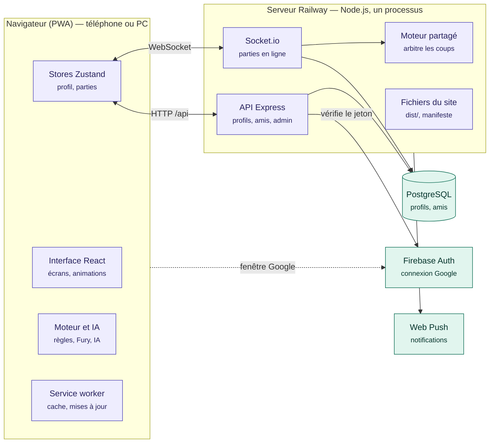

# Vesper — serveur, base de données et déploiement

Un seul processus Node (`server/index.js`) sert à la fois le site (`dist/`), l'API REST et le temps réel (Socket.io).

## Architecture



En violet, le code de Vesper ; en vert, les services externes. Une partie contre l'IA tourne entièrement dans le
navigateur (moteur et IA locaux) ; en ligne, chaque coup passe par Socket.io et le serveur l'arbitre avec le même
moteur (`src/lib/skyjoEngine.js`, `furyEngine.js`).

| Brique | Fichiers |
| --- | --- |
| Serveur HTTP + temps réel | `server/index.js` (port `PORT` ou 3000) |
| Base de données | `server/db.js`, `server/dbMigrations.js` |
| Vérification des jetons Google | `server/firebase.js` |
| Notifications | `server/utils/pushNotifications.js` |

- En développement, Vite (port 5173) relaie `/api` et `/socket.io` vers le port 3000 (`vite.config.js`).
- En production, Express sert les fichiers de `dist/`, et toute autre route renvoie `index.html` (application monopage).

## Base de données

Connexion (`server/db.js`) : `DATABASE_URL`, sinon `DATABASE_PUBLIC_URL`, sinon les variables `PG*`. SSL activé.

Les tables sont **créées et mises à jour automatiquement au démarrage** (`initDb` dans `server/index.js`, puis les
ajouts de colonnes de `server/dbMigrations.js`). Il n'y a pas d'outil de migration séparé : pour ajouter une colonne,
ajoutez une entrée dans `COLUMN_MIGRATIONS`.

| Table | Contenu |
| --- | --- |
| `users` | Profil : `id` (identifiant local `u-…`), `name`, `emoji`, `avatar_id`, `vibe_id` (Vesper ID), `level`, `xp`, `firebase_uid` (compte Google lié, unique), défis (`weekly_challenge_*`, `seasonal_challenge_wins`), `last_seen`, `migrated_to_v2` |
| `friends` | Relations `user_id` ↔ `friend_id` avec `status` (en attente / accepté) |
| `game_history` | Historique des parties |
| `push_subscriptions` | Abonnements aux notifications (un par joueur) |
| `feedbacks` | Retours des joueurs (type, statut, infos appareil) |

## API REST

| Route | Rôle |
| --- | --- |
| `GET /api/version` (alias `/api/config/version`) | Version déployée (lue dans `package.json`), jamais mise en cache |
| `GET /api/health` | État du serveur et de la base |
| `POST /api/social/profile` | Enregistre ou met à jour un profil |
| `GET /api/social/profile/:userId` | Lit un profil |
| `POST /api/social/migrate` | Marque un profil comme migré (ancienne migration locale vers le serveur) |
| `POST /api/auth/google-link` | Lie un compte Google au profil (voir [AUTHENTIFICATION.md](AUTHENTIFICATION.md)) |
| `GET /api/social/friends/:userId` | Amis d'un joueur |
| `POST /api/social/friends/request` · `/accept` · `/delete` | Demandes d'ami |
| `GET /api/social/search` | Recherche par Vesper ID ou par nom |
| `GET /api/social/leaderboard/global` · `/leaderboard/:userId` | Classements |
| `POST /api/push/subscribe` · `/unsubscribe` · `/track` | Notifications push |
| `POST /api/feedback` | Envoi d'un retour (limité en débit, validé) |
| `/api/feedback/admin/*` | Administration : retours, joueurs en ligne, liste et suppression de joueurs |

Routes : `server/index.js` et `server/routes/` (`social.js`, `feedback.js`, `push.js`).

### Administration

Les routes `/admin/*` exigent l'en-tête `x-admin-auth` (`server/middleware/adminAuth.js`). Le mot de passe est comparé
à `ADMIN_PASSWORD_HASH` (empreinte SHA-256), ou à `ADMIN_SECRET` (en clair ou en empreinte). **Sans aucune des deux,
le mot de passe par défaut `admin123` est accepté** : gardez ces variables définies en production.

## Temps réel (Socket.io) : le jeu en ligne

État en mémoire dans le processus (`rooms`, `userStatus`, `userMetadata`) : un redémarrage du serveur annule les
salons en cours.

| Événement reçu | Rôle |
| --- | --- |
| `register_user` | Associe la connexion à un joueur (présence en ligne) |
| `online_players` | Liste des joueurs connectés |
| `create_room`, `join_room`, `leave_room`, `change_mode` | Salons et mode de jeu (classique, `bonus` = Tourment, `fury`) |
| `start_game`, `next_round`, `rematch`, `toggle_pause` | Déroulé de la partie |
| `game_action` | Coup d'un joueur : `draw_pile`, `draw_discard`, `undo_draw_discard`, `replace_card`, `discard_and_reveal`, `discard_drawn`, `reveal_hidden`, `reveal_initial`, `use_action_card`, `perform_swap`, `activate_black_hole`, `play_fury` |
| `invite_friend`, `private_message`, `chat_typing` | Invitations et chat |

Le serveur **arbitre** chaque coup avec le même moteur que le jeu solo (`src/lib/skyjoEngine.js`, `furyEngine.js`),
puis diffuse l'état (`room_sync`). Événements émis : `room_created`, `room_list_update`, `room_sync`, `room_paused`,
`player_left`, `player_list_update`, `game_cancelled`, `gameplay_error`, `game_invitation`, `invitation_sent`,
`invitation_failed`, `private_message`, `chat_typing`, `user_presence_update`.

## Notifications push

Web Push avec des clés VAPID (`VAPID_PUBLIC_KEY`, `VAPID_PRIVATE_KEY`, `VITE_VAPID_PUBLIC_KEY` côté navigateur).
Envoi : `server/utils/pushNotifications.js` (invitations, etc.). Test manuel :
`node server/test_push_manual.js <ID_JOUEUR>`.

## Variables d'environnement

Modèle complet et commenté : `.env.example`. **Ne jamais y mettre de vraies valeurs** : le dépôt est public.

| Variable | Où | Rôle |
| --- | --- | --- |
| `DATABASE_URL` | serveur | Base PostgreSQL (interne sur Railway ; en local, l'URL publique) |
| `DATABASE_PUBLIC_URL`, `PG*` | serveur | Solutions de repli pour la base |
| `PORT` | serveur | Port HTTP (Railway le fournit ; 3000 par défaut) |
| `ADMIN_PASSWORD_HASH` / `ADMIN_SECRET` | serveur | Mot de passe d'administration |
| `VAPID_PUBLIC_KEY`, `VAPID_PRIVATE_KEY` | serveur | Notifications push |
| `FIREBASE_CLIENT_EMAIL`, `FIREBASE_PRIVATE_KEY` (+ `FIREBASE_PROJECT_ID` facultatif) | serveur | Compte de service Firebase (vérification des jetons Google) |
| `VITE_FIREBASE_*`, `VITE_VAPID_PUBLIC_KEY` | navigateur (intégrées au build) | Configuration Firebase web, clé publique push |

Les variables `VITE_*` sont lues **au moment du build** : après les avoir modifiées sur Railway, il faut redéployer.

## Déploiement (Railway)

- Projet Railway **SkyJo** : service **SkyJo-Scoring** (le jeu) et service **Postgres**.
- Domaine : `skyjo-scoring-production.up.railway.app`.
- Build Nixpacks (`nixpacks.toml`) : Node 20, `npm ci`, `npm run build`, `npm start`.
- **Chaque push sur `master` redéploie automatiquement.** Vérifiez ensuite `GET /api/version`.

Commandes utiles (CLI Railway, après `railway login` et `railway link`) :

```bash
railway deployment list --service SkyJo-Scoring
```

```bash
railway logs --service SkyJo-Scoring
```

## PWA : manifeste, icônes et mises à jour

- **Un seul manifeste** : `public/manifest.json`, déclaré dans `index.html`. Le plugin `vite-plugin-pwa` ne génère
  pas de manifeste (`manifest: false`) ; il ne fait que construire le service worker (`src/sw.js`).
- Le serveur interdit la mise en cache de `sw.js`, `index.html` et `manifest.json` (`server/index.js`).
- **Mise à jour du contenu** : le service worker détecte une nouvelle version et le jeu affiche un bandeau
  (`src/components/UpdatePrompt.jsx`) ; la nouvelle version s'active après accord du joueur.
- **Nom et icône de l'application installée** : gérés par Chrome, pas par le jeu. Chrome revérifie le manifeste au
  lancement, demande l'accord du joueur pour un changement de nom ou d'icône, puis installe la mise à jour une fois
  l'application fermée. Depuis Chrome 144, **une icône n'est considérée comme modifiée que si son adresse change** :
  pour changer une icône, changez son adresse (`/brand/vesper-v-512.png?v=3`, etc.), pas seulement le fichier.
  Diagnostic sur Android : `chrome://webapks` ; sur ordinateur : `chrome://web-app-internals`.
